# EduWallet — End-to-end user guide

How to issue, hold, share and verify an academic credential with EduWallet,
following three people through one complete story.

Every screenshot here is the real application, captured from a running
instance with the Polygon contracts connected. The certificates are genuinely
signed, the transaction hashes are real, and the verification counts are
actual recorded checks. Nothing is a mock-up.

**The cast.** Dr Anita Rao is the registrar at Northfield Institute of
Technology. Priya Sharma graduated from Northfield. An employer wants to check
Priya's degree without phoning the university.

---

## Contents

1. [What the product does](#1-what-the-product-does)
2. [Creating an account](#2-creating-an-account)
3. [The institution: issuing certificates](#3-the-institution-issuing-certificates)
4. [The institution: issuing a whole cohort](#4-the-institution-issuing-a-whole-cohort)
5. [The institution: managing and revoking](#5-the-institution-managing-and-revoking)
6. [The institution: analytics](#6-the-institution-analytics)
7. [The student: your credential wallet](#7-the-student-your-credential-wallet)
8. [The student: sharing a credential](#8-the-student-sharing-a-credential)
9. [The verifier: checking a certificate](#9-the-verifier-checking-a-certificate)
10. [The verifier: revoked and anonymised certificates](#10-the-verifier-revoked-and-anonymised-certificates)
11. [The public credential profile](#11-the-public-credential-profile)
12. [Account security: wallet export and password](#12-account-security-wallet-export-and-password)
13. [Losing your wallet: social recovery](#13-losing-your-wallet-social-recovery)
14. [On a phone](#14-on-a-phone)
15. [What to do when something goes wrong](#15-what-to-do-when-something-goes-wrong)

---

## 1. What the product does

A paper degree certificate can be forged with a photocopier, and verifying one
means emailing a registrar and waiting days. EduWallet replaces that with a
certificate that anyone can check in seconds and nobody can alter.

When Northfield issues a certificate, two things happen. The facts of the
certificate are hashed, and the institution's wallet signs that hash. The
certificate is then minted on Polygon as a soulbound token, a type of NFT that
can never be transferred or sold.

The signature is what matters most. A verifier does not have to trust this
website: they recover the signing address from the signature and compare it
with the institution's published address. That works even when the blockchain
is unreachable.

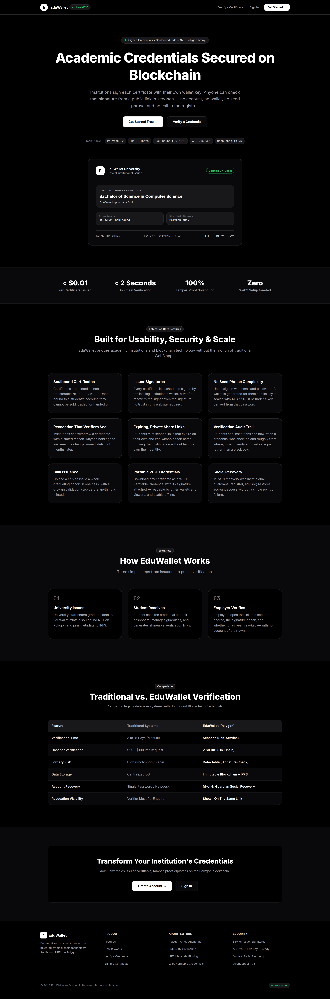

*The landing page. The badge beside the logo reports the live blockchain
connection, and says so honestly when there is none.*

---

## 2. Creating an account

Students and institution staff both register at `/register`. Verifiers never
need an account at all.

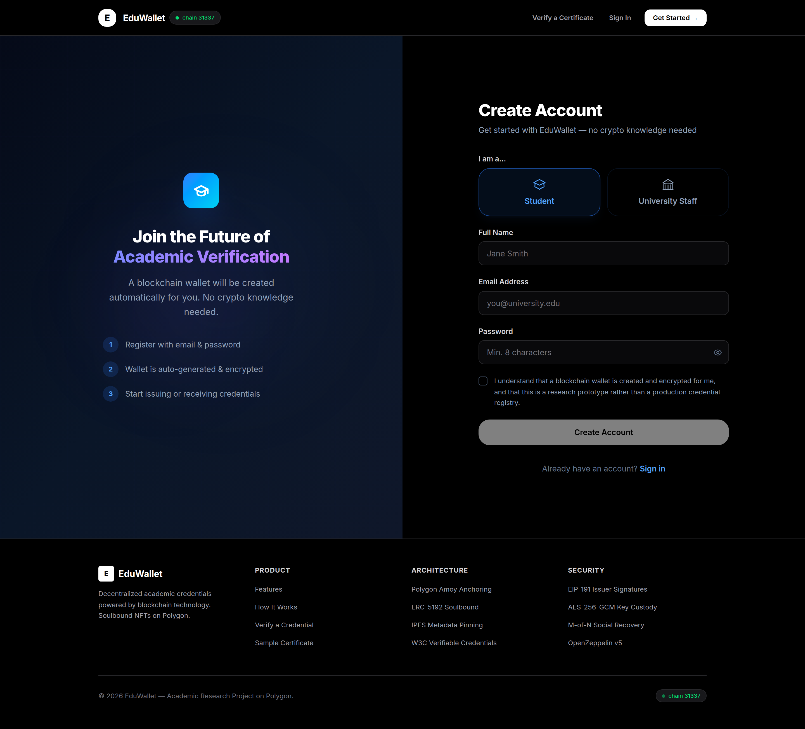

*Registration starts with the choice that matters: are you a student or
institution staff? The rest of the form changes to match.*

Choosing University Staff adds one required field, the institution name. This
is the name that appears on every certificate you issue, so it is worth typing
carefully.

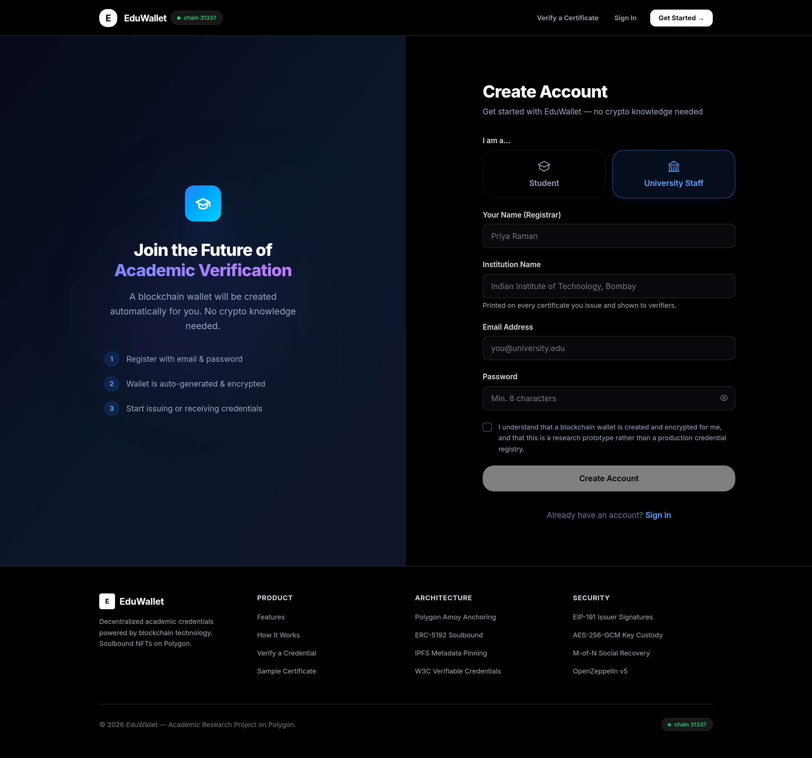

*The institution form. The name you give here appears on every certificate.*

A wallet is created for you automatically when you register. You do not need
MetaMask, you do not need to buy anything, and you never see a seed phrase
unless you ask for one. The wallet is an identity, not a bank account.

Your wallet key is encrypted twice over: once with a key derived from your
password, which only you can open, and once under the server's key, which is
what lets the system sign certificates on your institution's behalf.

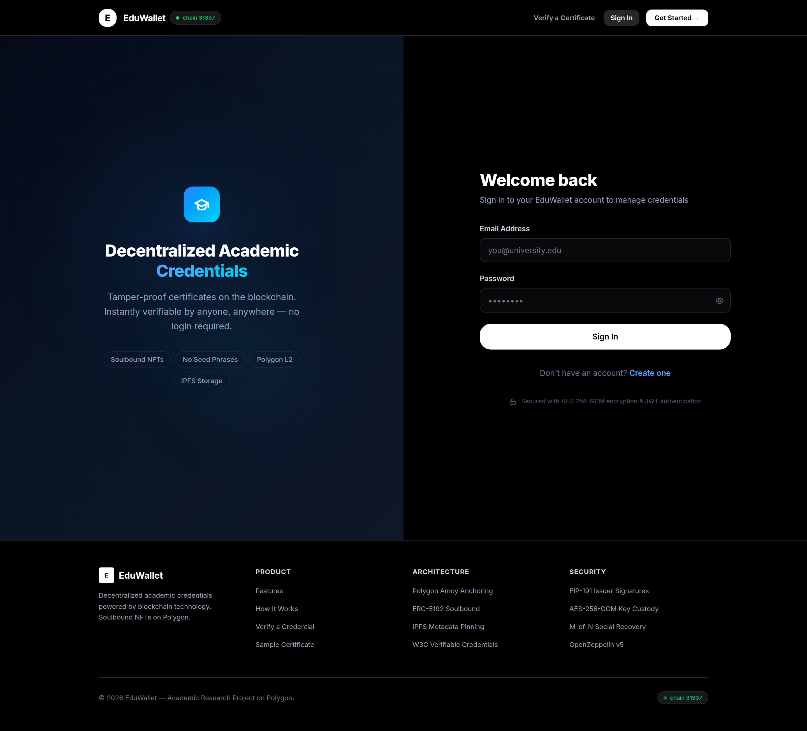

*Signing in afterwards. Sessions last 24 hours and are checked against the
server rather than trusted from the browser.*

---

## 3. The institution: issuing certificates

Dr Rao signs in and lands on the issuing form.

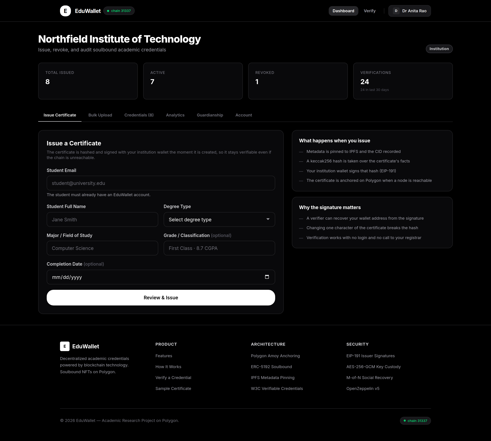

*The issuing form, with the institution's statistics across the top.*

Fill in the student's EduWallet email, their name as it should appear, the
degree type, the field of study, and optionally a grade and completion date.
The student must already have an EduWallet account, because the certificate is
issued to their wallet address.

Press issue and five things happen in order:

1. The student is resolved and validated.
2. The certificate metadata is pinned to IPFS. If pinning is unavailable the
   metadata is stored locally and the certificate says so.
3. A token ID is allocated atomically, so two simultaneous issuances can never
   collide.
4. The certificate is hashed and signed by your institution's wallet. **This
   step is what makes the certificate real.**
5. The certificate is minted on Polygon.

Only the signing step is mandatory. If the blockchain is unreachable the
certificate is still fully verifiable and the interface says plainly that it
has not been anchored, rather than implying otherwise.

The first time your institution issues anything, the platform automatically
authorises your wallet on the certificate contract and funds it with enough
gas to mint. You do not have to do anything, and it only happens once.

---

## 4. The institution: issuing a whole cohort

Issuing 400 graduations one form at a time is not realistic, so there is a
bulk tab that takes a CSV.

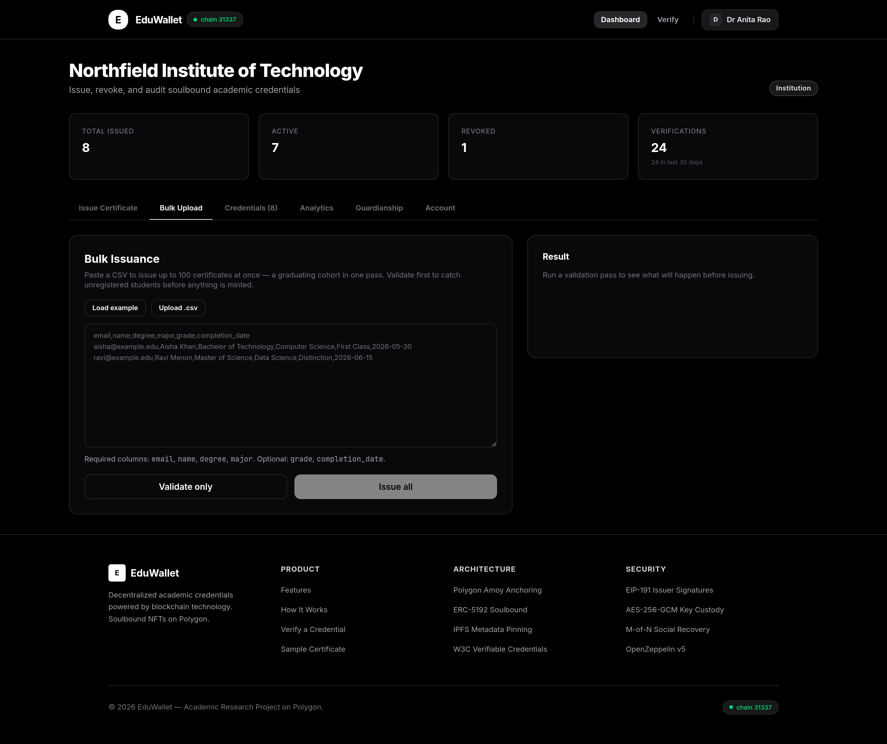

*Bulk issuance. Paste or upload a CSV, validate it, then issue.*

The CSV needs a header row. The columns `email`, `name`, `degree` and `major`
are required; `grade` and `completion_date` are optional. Column order does not
matter and common aliases are accepted, so `student_email` works as well as
`email`.

```csv
email,name,degree,major,grade,completion_date
daniel.okafor@student.edu,Daniel Okafor,Bachelor of Science,Physics,Upper Second,2026-06-12
sofia.marino@student.edu,Sofia Marino,Bachelor of Arts,Economics,First Class,2026-06-12
liam.walsh@student.edu,Liam Walsh,Master of Business Administration,Finance,Merit,2026-06-12
```

**Always run the validation pass first.** It parses the file and reports
problems by line number without issuing anything, so you can fix a malformed
row before it becomes 300 certificates.

When you do issue, rows are processed one at a time and a failure on row 7
does not roll back rows 1 to 6. The report tells you exactly which rows
succeeded and why each failure failed. Partial success is the normal outcome,
not an error. The limit is 100 rows per upload.

---

## 5. The institution: managing and revoking

Every certificate your institution has issued is in the credentials tab,
searchable and filterable by status.

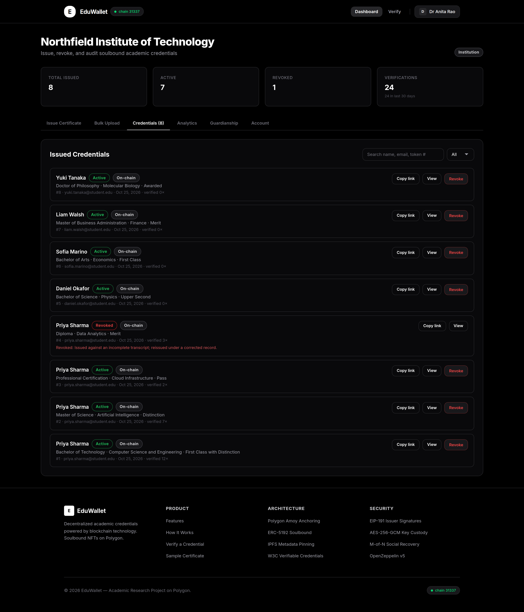

*The credentials tab. Search by student, filter by active or revoked, and see
how many times each certificate has been checked.*

Sometimes a certificate is issued in error. Revoking requires a written
reason, which is deliberate: the reason is shown to anyone who checks the
certificate afterwards, including on links the student has already given out.

Two things are worth understanding about revocation.

**The signature is preserved.** A revoked certificate still shows a valid
signature, because the document really was issued and later withdrawn. That is
a different thing from a forgery, and the interface distinguishes them.

**It propagates immediately.** Every link already handed out starts showing
the certificate as withdrawn, with the reason, on the next page load. There is
nothing to recall.

When the certificate was anchored on the blockchain, the revocation is
recorded there too.

---

## 6. The institution: analytics

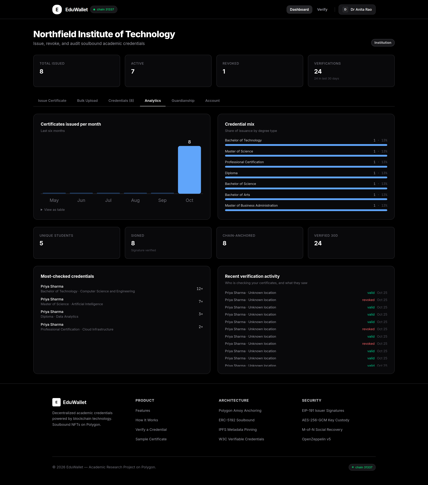

*Issuance volume by month, the mix of credential types, which certificates are
being checked most, and recent verification activity.*

The most useful number here is usually the verification activity. It tells you
which of your graduates are actively job-hunting and which credentials
employers actually check, which is information a paper registry cannot give
you at all.

Verification records show a coarse location such as a city and country, never
a raw IP address. Students see the same data for their own certificates.

---

## 7. The student: your credential wallet

Priya signs in and sees everything Northfield has issued her.

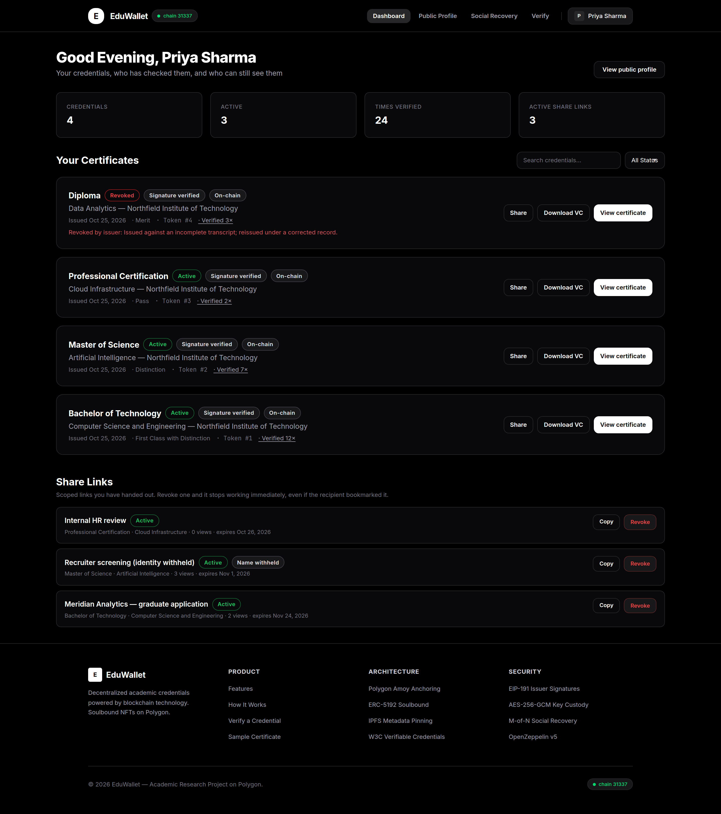

*The student dashboard. Certificates, search and filter, share links, and
verification history.*

Each certificate shows whether it is valid, whether its signature checks out,
whether it is anchored on the blockchain, and how many times it has been
verified.

You can download any certificate as a **W3C Verifiable Credential**, a
standard JSON-LD document with the signature attached. It opens in other
credential wallets and viewers, and it keeps working if EduWallet disappears
tomorrow. This matters: your qualification should not be hostage to one
website.

---

## 8. The student: sharing a credential

A permanent public link that names you is rarely what you want to send an
employer. They need to confirm one degree, once.

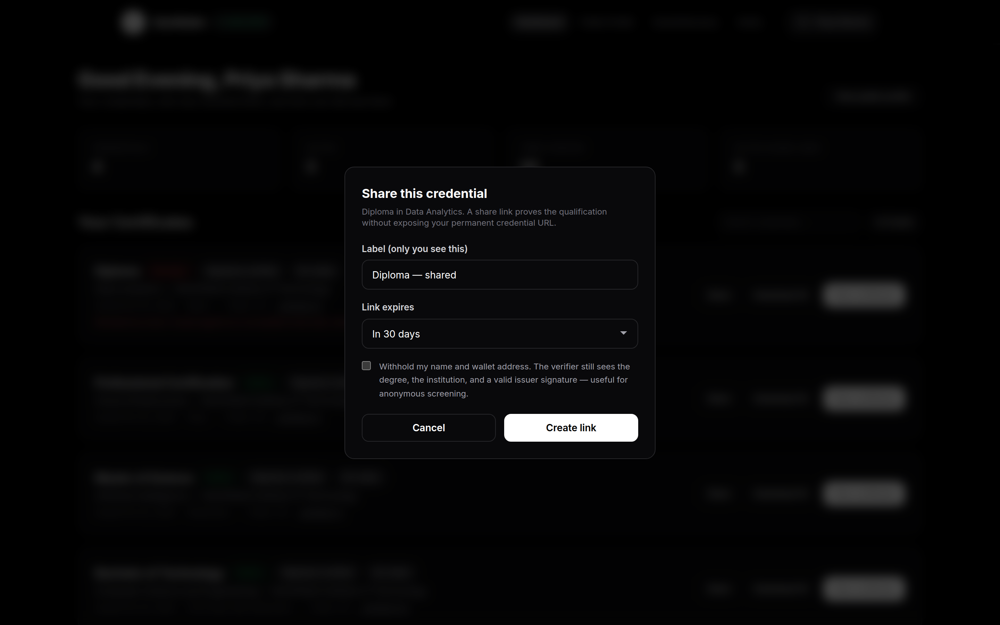

*Creating a share link: a label so you remember who you gave it to, an expiry,
and the option to withhold your identity.*

Three choices:

| Setting | Options | Why it matters |
|:--|:--|:--|
| Label | Free text | Shows in your dashboard so you know which link went where |
| Expiry | 24 hours, 7 days, 30 days, never | The link stops working on its own |
| Withhold identity | On or off | Proves the qualification without naming you |

**Withholding identity** is the interesting one. The verifier sees the degree,
the field, the grade, the institution and a valid signature, but not your name
or wallet address. It is useful for a recruiter screening candidates before a
shortlist.

You can revoke any link instantly from your dashboard, and you can see how many
times each one has been viewed and when it was last opened. You may hold up to
25 active links at a time.

---

## 9. The verifier: checking a certificate

The employer has no account and does not want one. They go to `/verify`.

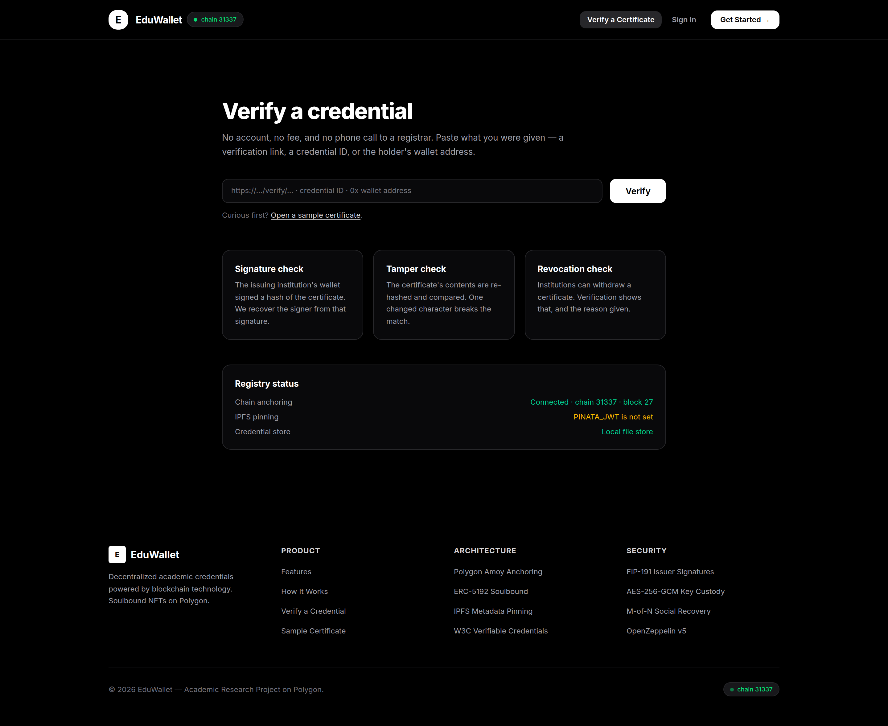

*One input accepts a full verification link, a certificate ID, or the holder's
wallet address. The registry status panel reports what the system can
currently do.*

Pasting a link produces the verdict screen.

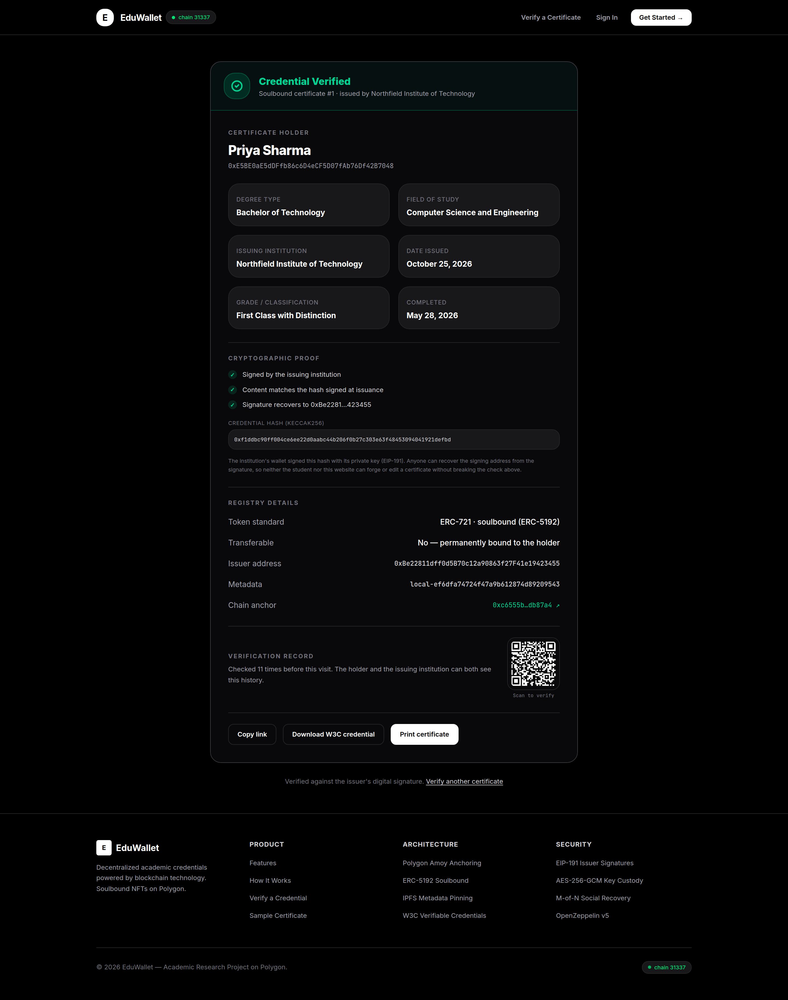

*A verified certificate, anchored on the blockchain.*

Read it from the top. The verdict comes first, then the facts of the
qualification, then the evidence behind the verdict.

The **cryptographic proof** section is the heart of it. Three checks are shown
separately rather than collapsed into one tick:

1. **Signed by the issuing institution.** A signature exists.
2. **Content matches the hash signed at issuance.** Nothing has been edited
   since. Change one character of the student's name and this fails.
3. **Signature recovers to the issuer's address.** The signature was made by
   the institution's wallet and not by anyone else.

Below that, the **registry details** show the token standard, confirmation
that the certificate is permanently bound to its holder, the issuer's address,
and the blockchain transaction, which links out to a block explorer.

The **verification record** shows how many times the certificate has been
checked before this visit. A QR code links back to the same verification page
so a printed copy can be re-checked from paper.

Three actions at the bottom: copy the link, download the W3C credential file,
or print the certificate on a clean print layout.

**If the blockchain is unreachable**, the three cryptographic checks still
pass and the certificate still verifies. Only the anchoring line changes, to
say the certificate has not been anchored. This is a weaker provenance claim,
not a failed verification, and the interface is careful about the difference.

---

## 10. The verifier: revoked and anonymised certificates

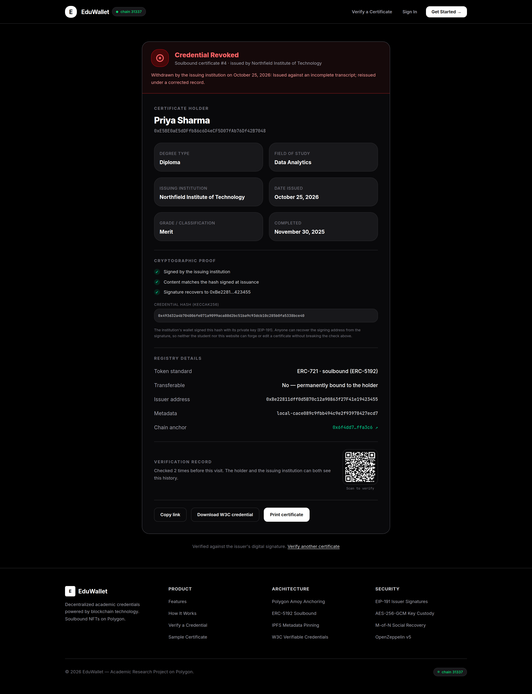

*A revoked certificate, with the institution's stated reason.*

Note what is happening here. The certificate is marked as withdrawn, the
reason given by the institution is shown, and the signature still checks out,
because the document genuinely was issued. A verifier can tell the difference
between an administrative withdrawal and a forgery.

There is a third verdict. If a certificate's contents no longer match its
signed hash, verification reports **tampered** rather than showing a
valid-looking document. Tampering outranks revocation, because it is a
forgery question rather than an administrative one.

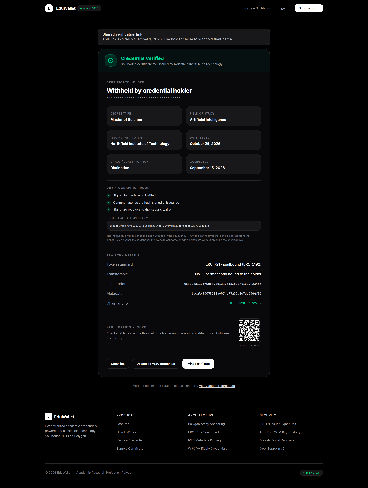

*An anonymised share link. The qualification is proven; the holder is not
named.*

The holder's name and wallet are withheld, the label and expiry of the link
are shown, and the signature check still passes. The verifier learns that
Northfield awarded this qualification without learning who to.

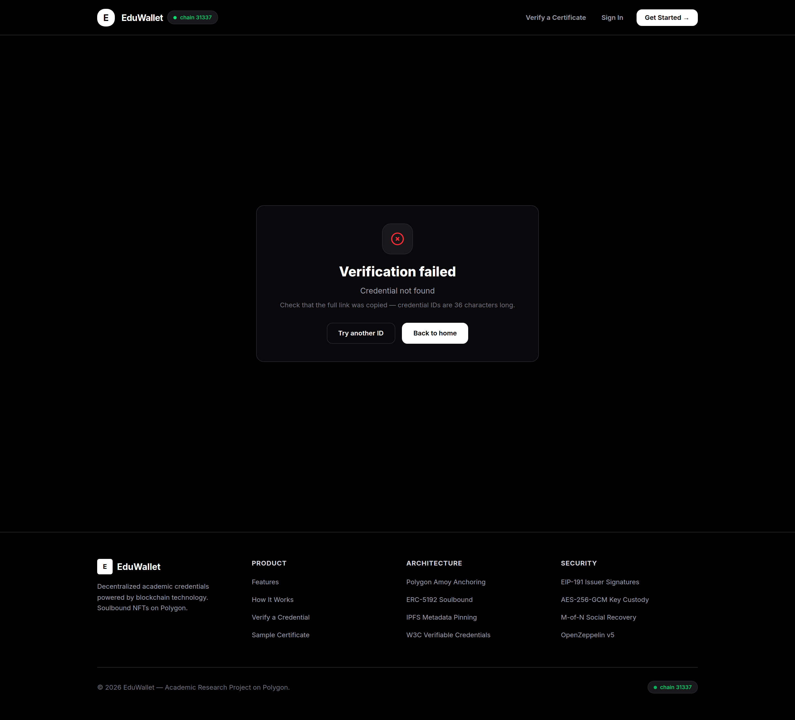

*A certificate ID that does not exist. Certificate IDs are 36 characters and
are frequently truncated when pasted out of an email, so the message says so
rather than implying fraud.*

---

## 11. The public credential profile

Every student has a citable public profile at `/u/` followed by their wallet
address. It is a verifiable résumé.

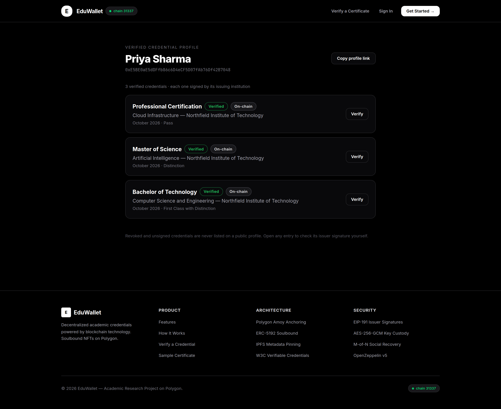

*A public credential profile listing active, signature-valid credentials.*

Only credentials that are both active and cryptographically valid appear here.
Anything revoked or unverifiable is left off, because a public profile is a
claim about someone. The student's email never appears.

If a student has recovered their account to a new wallet, old profile links
keep working.

---

## 12. Account security: wallet export and password

The standard criticism of a custodial credential wallet is that the holder
never really owns anything. This is the escape hatch.

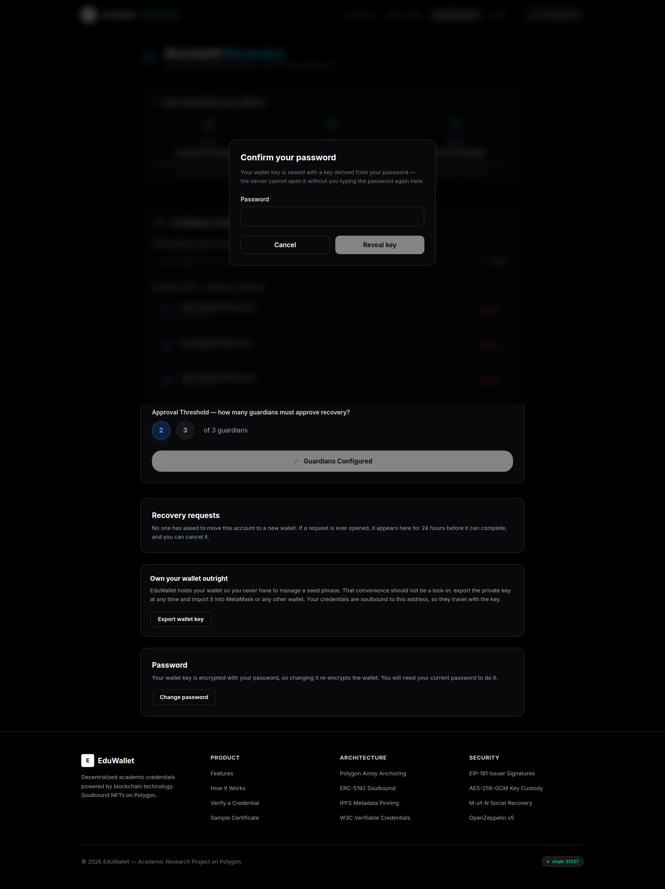

*Wallet export. Re-enter your password and the private key is shown once.*

The key is decrypted from the copy sealed under your password, displayed once,
and never logged, stored or emailed. With it you control the wallet holding
your certificates independently of this application.

Treat it like a password you can never change. Anyone holding it controls that
wallet.

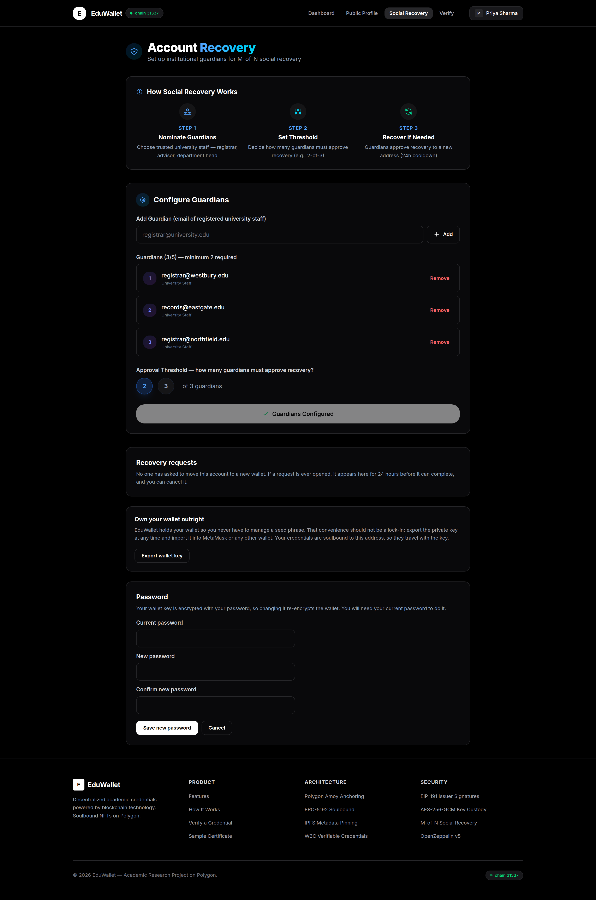

*Changing your password.*

Changing your password is not just a hash swap. Your wallet key is encrypted
with a key derived from your password, so the change decrypts and re-encrypts
the wallet in the same operation. That is why your current password is
required even though you are already signed in.

Institutions have the same controls in their own account tab.

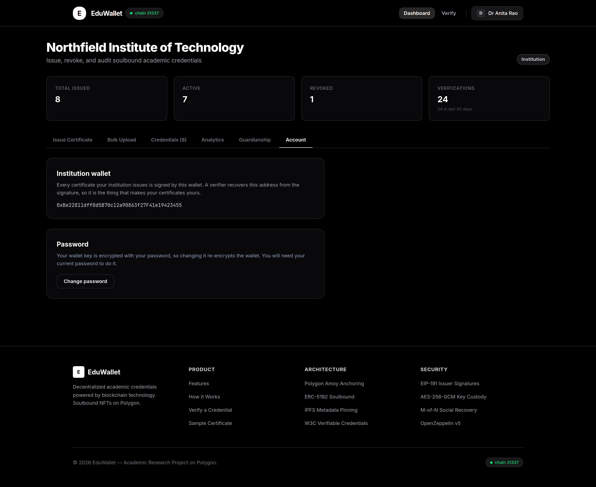

*The institution account tab. The wallet shown here is the one that signs
every certificate you issue, so a verifier recovering this address from a
signature is what proves the certificate is yours.*

---

## 13. Losing your wallet: social recovery

If you lose access to your wallet, there is no support desk that can hand it
back. Instead, you nominate institutions you trust as guardians ahead of time.

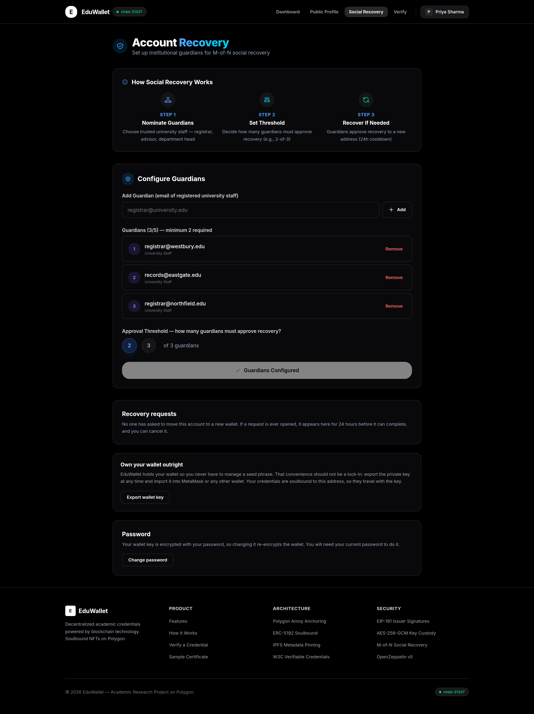

*Configuring guardians. Nominate between two and five institutions and choose
how many must agree.*

Pick between two and five institution accounts, then set a threshold: how many
of them must agree before your account can be moved. Your guardian set is
recorded both in EduWallet and on the RecoveryManager contract.

### How a recovery actually runs

| Step | Who | What happens |
|:--|:--|:--|
| 1 | A guardian | Opens a request naming your new wallet address. This counts as the first approval |
| 2 | Other guardians | Approve until the threshold is reached |
| 3 | Nobody | A 24-hour safety delay runs |
| 4 | A guardian or you | Completes the migration |

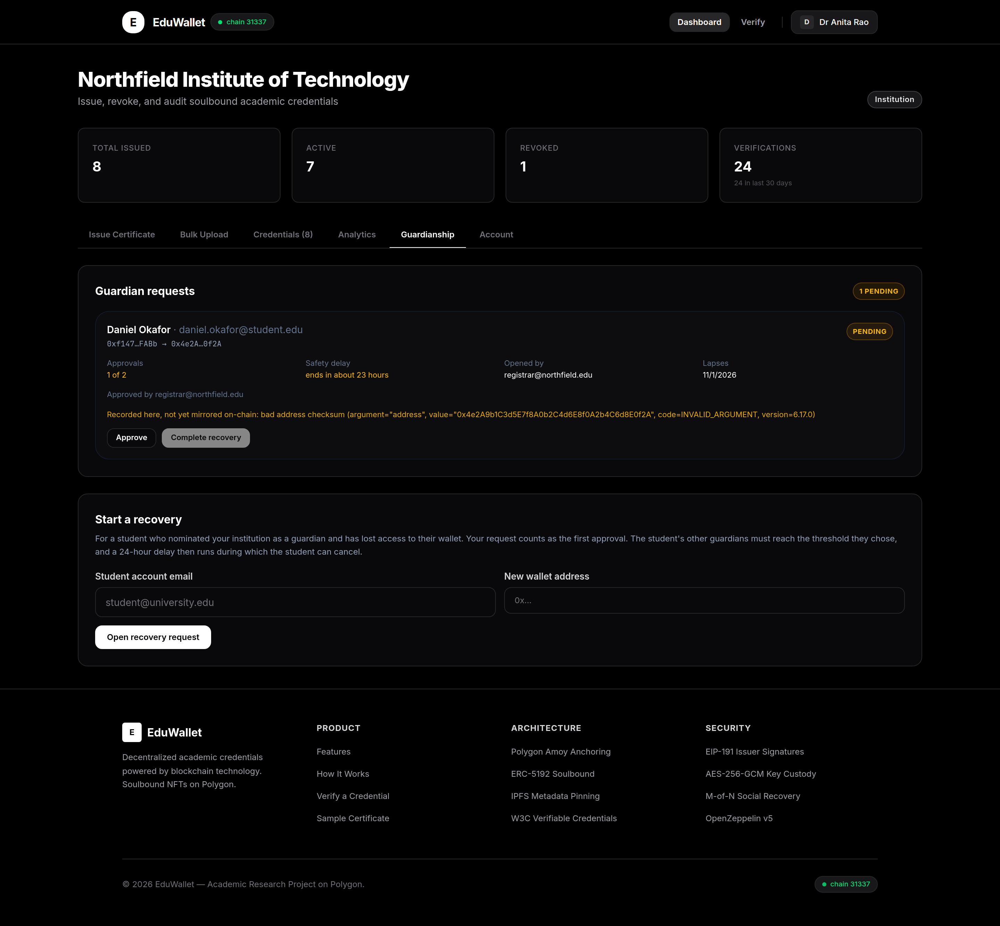

*The institution's guardianship tab: open a request for a student who has lost
access, and approve or complete pending ones. The Complete button stays
disabled until both the approval threshold and the delay are satisfied.*

### Your veto

The 24-hour delay is the point. For its whole duration the request appears on
your account page with a cancel button.

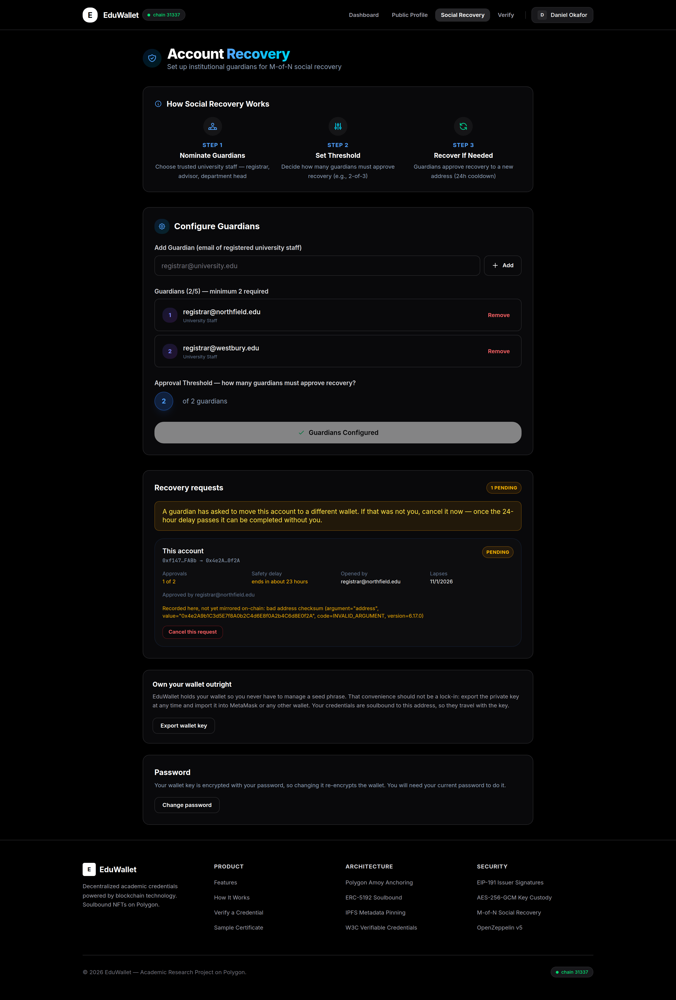

*A pending recovery request seen by the account holder, with the approvals
collected, the time remaining, and the cancel button.*

If you did not ask for this, cancel it. Only you can. A guardian cannot cancel
a request, which is what stops guardians colluding to take an account.

A request that nobody completes lapses after seven days.

### After a recovery

Your account moves to the new wallet address, and your old address is
remembered. Your existing certificates were signed over the old address, so
they cannot be rewritten, and they do not need to be: lookups span your whole
address history. Your dashboard, your share links and your public profile all
keep working under either address.

Wallet export afterwards gives you the key to the original wallet, which is
the one holding the already-minted certificates.

---

## 14. On a phone

Students mostly open EduWallet on a phone, and employers often open a
verification link from an email on one.

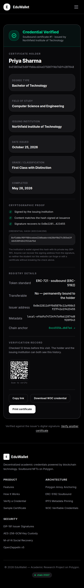
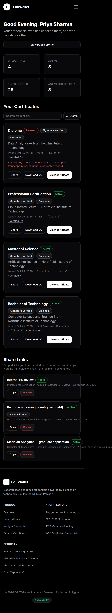

*Verification and the student dashboard at 390 pixels wide.*

---

## 15. What to do when something goes wrong

| What you see | What it means | What to do |
|:--|:--|:--|
| Off-chain mode in the header | No blockchain connection | Nothing. Certificates still verify by signature |
| Read-only beside the network name | Chain reachable but no relayer key | An administrator must set `PLATFORM_PRIVATE_KEY` |
| Anchoring pending on a certificate | Signed but not yet on the blockchain | Nothing. It is still verifiable |
| Demo storage mode banner | No durable database configured | An administrator must set up storage. Data will be lost on restart |
| Certificate could not be signed | The institution wallet needs re-keying | Sign out and back in, then reissue |
| Session expired | Your 24-hour session ran out | Sign in again |
| Too many sign-in attempts | Rate limit | Wait a few minutes |
| No EduWallet account for that email | The student has not registered | Ask them to register first, then reissue |
| IPFS pinning unavailable | Metadata stored locally instead | Nothing. It does not affect verification |

Administrators can check the live state of every dependency at
`/api/system/status`, which reports the storage mode, whether the relayer is
configured, and whether each contract answers.

---

## Appendix: the three verdicts

| Verdict | Meaning | Signature | Shown as |
|:--|:--|:--|:--|
| Valid | Genuine and in force | Checks out | Verified |
| Revoked | Genuinely issued, later withdrawn | Checks out | Withdrawn, with the reason |
| Tampered | Contents no longer match the signed hash | Fails | The loudest state in the product |

A fourth outcome, not found, means no certificate exists with that identifier.
It is usually a truncated link rather than anything sinister.
